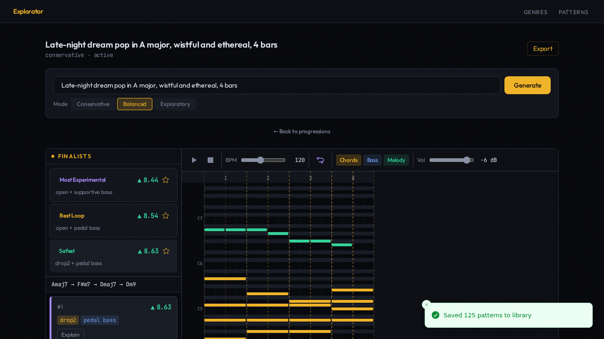
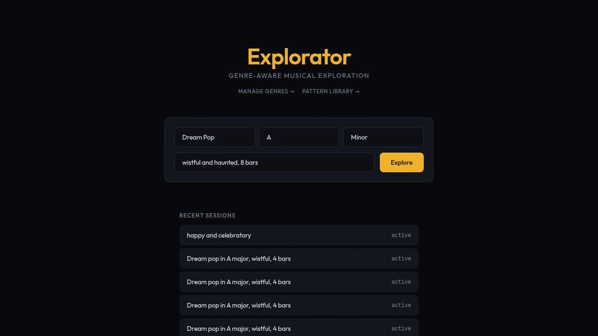
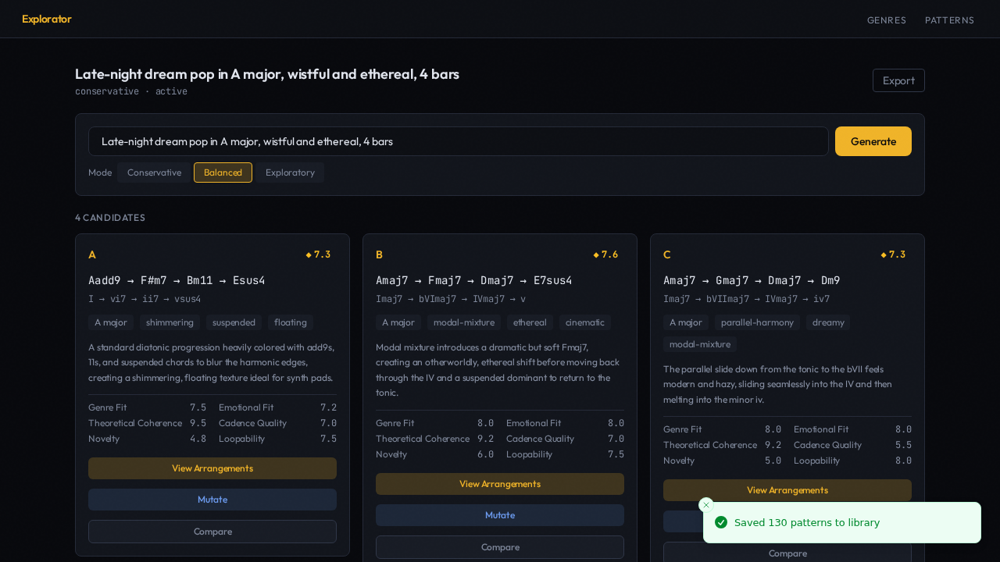
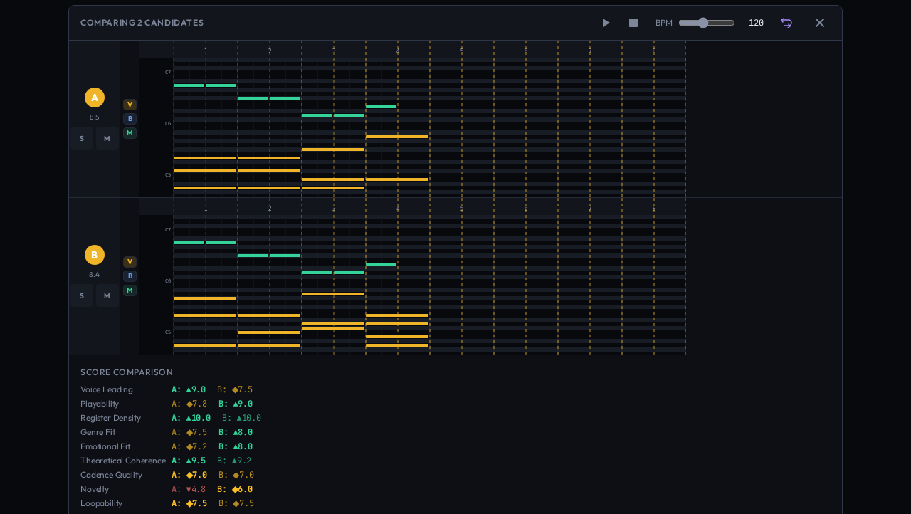
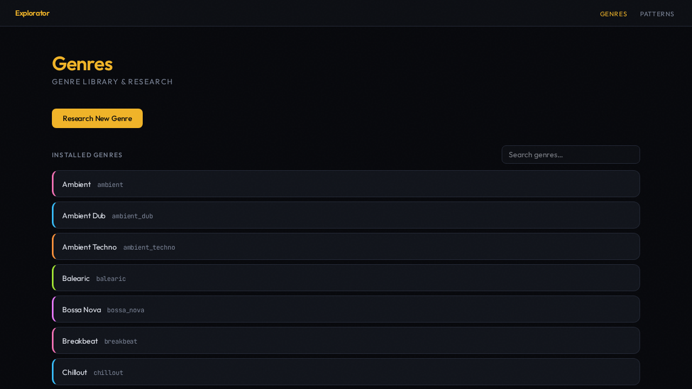
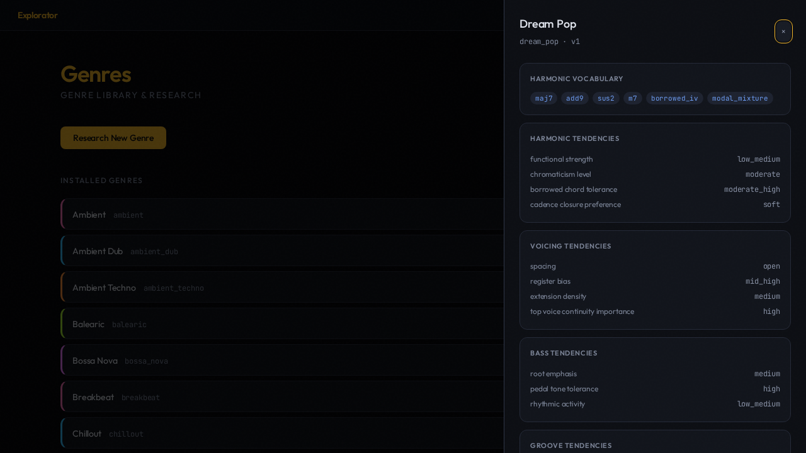
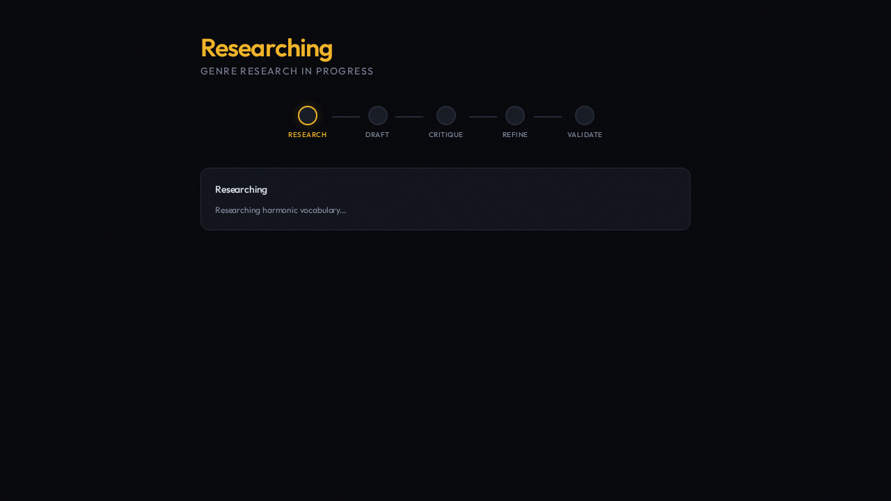
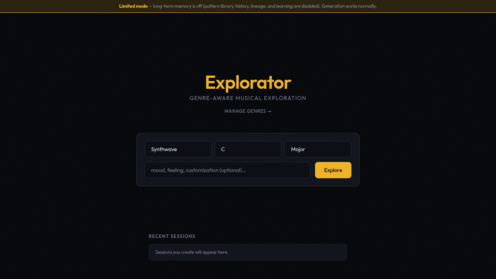

# Explorator

A creative copilot for music producers. Generate chord progressions, realize them into voiced arrangements with bass / groove / melody, evaluate and rank the results, mutate promising candidates, and build a personal library of curated patterns over time.



## What it does

**Create**
- Choose genre, key, and mode up front, then steer with an optional mood prompt (*"wistful and haunted, 8 bars"*) — translated into structured musical constraints
- Generate candidate chord progressions across 39 genre profiles via an LLM (pro tier)
- Realize progressions into arrangements: voicings (open, close, drop-2, drop-3), genre-specific bass modes, groove patterns, optional melodic complement
- Score arrangements across 12 dimensions (deterministic music theory + LLM)
- Mutate promising candidates: substitute, extend, transform — optionally steered by plain-text guidance





**Refine**
- Multi-round exploration with per-round finalists (safest / best-loop / most-experimental)
- Plain-text feedback reweights the scorer across rounds (backend API `POST /v1/sessions/{id}/feedback`, Neo4j mode only; no UI yet)
- Pareto ranking surfaces distinct trade-offs rather than a single "winner"
- See the cost: a live token-usage panel shows per-round and per-phase LLM token counts with an estimated dollar cost (or "not priced" when no rates are configured), ticking up as the pipeline runs

**Play & compare**
- Piano roll with amber voicing, blue bass, emerald melody, groove-accent overlay
- Tone.js playback with genre-matched synth presets
- DAW-style comparison view: load two or more candidates' arrangements into mute/solo lanes with synchronized transport



**Export & curate**
- MIDI + JSON export of any arrangement, with LLM-generated explanation and full provenance trace
- Pattern library: every finalist auto-harvests its progression, voicing, bass, groove, and melody patterns
- Star your favourites; filter `/patterns` to *Curated only*

## The genre catalog

39 genres ship with the system. Browse them in `/genres`; click any tile to open a side drawer with the genre's harmonic vocabulary, tendencies, anti-patterns, and voicing/bass/groove preferences.





Each genre is a triplet of YAML files that together drive every musical decision the engine makes:

| File | What it captures | Used by |
|---|---|---|
| **Profile** ([`domain/style/genres/`](./backend/src/explorator/domain/style/genres/)) | Harmonic vocabulary, tendency knobs (functional strength, chromaticism, cadence preference), voicing/bass/groove/melodic preferences, experimentation envelope per layer | Generators (progressions, voicings, bass, groove, melody) — the "default settings" for the genre |
| **Rules + anti-patterns** ([`domain/style/rules/`](./backend/src/explorator/domain/style/rules/)) | Named rules with weights and applicability (e.g. `glacial_attack_times` for ambient voicing), plus anti-patterns with severity (e.g. `staccato_rhythmic_comping` for ambient groove) | Evaluators — rules add positive bias, anti-patterns subtract |
| **Grammar** ([`domain/style/grammars/`](./backend/src/explorator/domain/style/grammars/)) | Preferred chord qualities, allowed borrowed chords, cadence archetypes, harmonic rhythm defaults (per time-signature), functional-motion bias | Progression generator — constrains the space the LLM is asked to explore |

**See a concrete example — Ambient:** [`ambient.yaml`](./backend/src/explorator/domain/style/genres/ambient.yaml) (profile) · [`ambient_rules.yaml`](./backend/src/explorator/domain/style/rules/ambient_rules.yaml) (rules + anti-patterns) · [`ambient_grammar.yaml`](./backend/src/explorator/domain/style/grammars/ambient_grammar.yaml) (grammar). Schemas: [`schema.py`](./backend/src/explorator/domain/style/schema.py).

The seed three (Dream Pop, Synthwave, Cinematic) are hand-curated. The other 36 were produced by the **genre research agent** (M5c) — a five-step pipeline you can run yourself from the `/genres` UI:

```
research  →  draft  →  critique  →  refine  →  validate
   ↑                       │
   │                       ↓ (if not passed, up to 2 refine cycles)
   └──── musicology research log
```

Concretely, you type a genre name (e.g. *"Trip-Hop"*), optionally add reference artists, and click *Start research*. The agent:

1. **Researches** the genre via the pro-tier LLM — produces a free-text musicology log.
2. **Drafts** all three YAMLs from the research, deterministically validated against the Pydantic schema.
3. **Critiques** the draft via the flash-tier LLM with fresh context (no research log) — independent review.
4. **Refines** if the critique flagged issues (up to two iterations).
5. **Validates** the final result against the schema and surfaces the result for you to **approve** (write to disk, immediately usable for new sessions) or **reject** (logged to the audit trail with the reason).

Approved genres land in the same three directories as the seed genres and are synced to Neo4j right away, so they are available for new sessions immediately — no special handling, no separate code path. The UI's step indicator + research-log view lets you watch the pipeline run live; the audit trail of critique iterations is preserved on the job record so you can see *why* a genre took the shape it did.



## Status

**M0 → M5d shipped**, plus cross-cutting token-usage instrumentation ([ADR 011](docs/decisions/011-token-usage-instrumentation.md)). M6 (multi-layer mutation) is specced and pending. See [`docs/design/plans/`](./docs/design/plans/) for the milestone history, or [`docs/ARCHITECTURE.md`](./docs/ARCHITECTURE.md#pipelines) for the current pipeline shape.

| | |
|---|---|
| Backend | pytest (unit + integration + API), all green in CI |
| Frontend | vitest, tsc strict, `npm run build` clean |
| E2E | Playwright under `LLM_MOCK=true`; the memory-mode lane runs in CI (occasional flake on `ux-coherence:11 navigation-flow`, passes in isolation) |

## Quick start

**Prerequisites:** [uv](https://docs.astral.sh/uv/) (installs Python 3.13+ for you), Node.js 20.19+ or 22.12+, GNU make, Docker (for Neo4j and the backend test suite), and an LLM: a Gemini or OpenAI API key, or a local OpenAI-compatible server (Ollama, vLLM, ...) — or none, using `LLM_MOCK=true` for deterministic fake output.

```bash
git clone https://github.com/Blevene/Explorator.git
cd Explorator

# Configure
cp .env.example backend/.env
# Edit backend/.env and set LLM_API_KEY (or configure another provider — see "LLM providers").
# Only Explorator's own settings are read from backend/.env (see "LLM providers").
# The default Neo4j password ('explorator_dev') is for local dev only — change
# it (and the docker-compose value) if you ever expose Neo4j beyond localhost.

# Install deps
cd backend  && uv sync --all-extras && cd ..
cd frontend && npm install         && cd ..
```

> **Neo4j is optional.** The full generation flow — M1 progressions → M2
> realization → M3 mutations — runs without a database via a process-lifetime
> in-memory store. `make neo4j-up` is required only for *durable* storage and the
> long-term-memory features: pattern library, feedback learning, session
> history, lineage, genre research, and curation. See
> [Neo4j is optional (limited mode)](#neo4j-is-optional-limited-mode).

**Run** — two modes, no config flag to switch between them. The backend probes
Neo4j once on startup and picks the mode automatically.

*Full mode — with Neo4j* (all features, durable across restarts):

```bash
make neo4j-up        # dev Neo4j on :7688 — returns once the container is healthy
make backend         # FastAPI on :8000 — connects to Neo4j (terminal 1)
make frontend        # Vite on :5173, proxying /v1 to :8000 (terminal 2)
```

The backend probes Neo4j only once, at startup (3 s timeout). If it logged
"In-memory mode — long-term memory features disabled", Neo4j wasn't ready —
restart the backend.

*Limited mode — no Neo4j* (in-memory; generation only). Just don't start Neo4j —
the backend finds it absent and runs against a process-lifetime in-memory store:

```bash
make backend         # logs "In-memory mode — long-term memory features disabled"
make frontend        # the UI shows a "limited mode" banner
```

`make frontend` points Vite's `/v1` proxy at `make backend` (:8000). Running
`npm run dev` directly instead proxies to `VITE_API_TARGET`, which defaults to
`http://localhost:8100` (the E2E backend).

**No LLM key?** `LLM_MOCK=true make backend` runs the full UI against deterministic
fake LLM output. `LLM_MOCK` is read from the process environment only — export it or
prefix the command; don't put it in `backend/.env`. The backend test suite needs no key.

Open http://localhost:5173. Generation (M1 → M2 → M3) works in **both** modes;
limited mode turns off the long-term-memory features and loses data on restart —
see [Neo4j is optional (limited mode)](#neo4j-is-optional-limited-mode). Check the
live mode any time with `curl localhost:8000/v1/capabilities`.

**Test**

```bash
make test                       # Backend full suite (auto-starts isolated test Neo4j on :7689)
make lint                       # ruff + mypy strict
cd frontend && npm run test:unit && cd ..

# End-to-end (Playwright spawns its own servers, all under LLM_MOCK=true — no
# API key needed for e2e). One-time setup:
cd e2e && npm install && npx playwright install --with-deps chromium && cd ..
make e2e-parallel               # UI/generation specs — fully parallel, each worker on its
                                #   own in-memory backend; no Neo4j needed (~30s)
make neo4j-up                   # REQUIRED before e2e-neo4j / e2e: dev Neo4j on :7688
make e2e-neo4j                  # durable-feature specs (pattern library, genre research,
                                #   feedback/lineage) — serial against the dev Neo4j
make e2e                        # both lanes (also needs `make neo4j-up` first)
```

`make e2e-neo4j` — and the Neo4j half of `make e2e` — require the dev Neo4j to be
running; bring it up with `make neo4j-up` first. Setup hard-fails with a clear
message if the backend can't reach Neo4j (it would otherwise boot in memory mode
and the learning specs would fail with confusing UI errors). `make e2e-parallel`
needs no Neo4j. None of the lanes need an `LLM_API_KEY`: e2e always runs with
`LLM_MOCK=true`. `E2E_WORKERS` (default 4) sets parallelism for `make e2e-parallel`.

The Neo4j lane cleans up via `docker exec` on the dev Neo4j container, by default
`explorator-neo4j-1`. If your container has another name (e.g. the clone directory
isn't `Explorator`), set `NEO4J_CONTAINER=<name>` (see `docker compose ps`).

The pytest suite wipes the DB between tests, so it runs against a dedicated `neo4j-test` container on port 7689 — the dev DB on 7688 is never touched. `make test*` brings the test container up automatically; if you invoke pytest directly, run `make neo4j-test-up` first.

## LLM providers

Explorator talks to an LLM through one of two adapters, chosen by `LLM_PROVIDER`
in `backend/.env` (see `.env.example` for full recipes). `backend/.env` holds only
Explorator's settings (`LLM_*`, legacy `GEMINI_*`, `NEO4J_*`, ...); an unknown `LLM_*` /
`GEMINI_*` key there stops startup with a "did you mean …?" message, because a typo such as
`LLM_PROVDER` would otherwise leave Gemini selected and send your key to Google. Other
unknown keys, and shell variables that look like misspelled settings, only log a warning. `LLM_MOCK`, `OPENAI_API_KEY` and server-side
variables such as `OLLAMA_CONTEXT_LENGTH` are read from the process environment only:
export them or prefix the command (e.g. `LLM_MOCK=true make backend`).

| Provider | `LLM_PROVIDER` | Required | Notes |
|---|---|---|---|
| Google Gemini (default) | `gemini` | `LLM_API_KEY` | Native SDK; models default to `gemini-pro-latest` / `gemini-flash-latest` |
| OpenAI | `openai` | `LLM_API_KEY`, `LLM_PRO_MODEL`, `LLM_FLASH_MODEL` | Leave `LLM_BASE_URL` empty. Instead of `LLM_API_KEY` you can leave it empty and export `OPENAI_API_KEY` in the shell (not in `backend/.env`) |
| Ollama | `openai` | `LLM_BASE_URL=http://localhost:11434/v1`, both models | No key needed |
| vLLM / LM Studio / OpenRouter | `openai` | `LLM_BASE_URL=…/v1`, both models; `LLM_API_KEY` if the server checks one (always for OpenRouter; vLLM started with `--api-key`) | Without `LLM_API_KEY`, the placeholder key `not-needed` is sent |

`LLM_PROVIDER=openai` requires `LLM_PRO_MODEL` and `LLM_FLASH_MODEL`; the backend
refuses to start without them, and also refuses an unknown `LLM_PROVIDER` value.

The legacy `GEMINI_*` settings (`GEMINI_API_KEY`, `GEMINI_PRO_MODEL`,
`GEMINI_FLASH_MODEL`, `GEMINI_TIMEOUT_SECONDS`, `GEMINI_PRICE_*`) are deprecated.
Under `gemini` they fill any unset `LLM_*` value, with a deprecation warning at
startup. Under `openai` they are not used — a startup warning names each one that is
set — so a Google API key is never sent to a third-party endpoint and Gemini prices
never apply to other models. An explicit `LLM_PRICE_*=0` beats a legacy
`GEMINI_PRICE_*` value. `GEMINI_MOCK=true` is the deprecated spelling of
`LLM_MOCK=true` and still works (with a warning) under either provider.

The **pro** model handles harmony generation, mutation, explanations and the
genre-research step; the **flash** model handles intent parsing, feedback
interpretation, evaluation, voicing/melody planning, and genre drafting, critique and
refinement. Using one model for both is fine.

**Gemini-only vs `openai`-only settings.** Under `gemini`, only `LLM_API_KEY`, the
two model names, `LLM_TIMEOUT_SECONDS` and `LLM_PRICE_*` apply. `LLM_BASE_URL`,
`LLM_MAX_RETRIES`, `LLM_MAX_CONCURRENCY`, `LLM_CONTEXT_TOKENS` and `LLM_EXTRA_BODY`
affect the `openai` provider only.

**Base URL must end in `/v1`.** A 404 when a round starts usually means it doesn't.

**Context length (Ollama).** Ollama's default context window (2–4k tokens) silently
truncates Explorator's longer prompts, and the `/v1` API can't change it per request.
Start the server with `OLLAMA_CONTEXT_LENGTH=16384` (or set `num_ctx` in a Modelfile),
and set `LLM_CONTEXT_TOKENS` (unset by default) to the same value so Explorator warns
when a prompt nears it.

**Concurrency and timeouts.** Rounds fan out several LLM calls at once.
`LLM_MAX_CONCURRENCY` (default 4) applies to the `openai` provider only and caps in-flight requests; for Ollama,
keep it ≤ `OLLAMA_NUM_PARALLEL`. `LLM_TIMEOUT_SECONDS` defaults to 120 for `gemini`
and 300 for `openai`. `LLM_MAX_RETRIES` (default 1, `openai` only) is the HTTP retry
count for connection errors, 429s and 5xx; both adapters also retry once on
malformed JSON.

On `gemini`, `LLM_TIMEOUT_SECONDS` is passed to google-genai as both the client
timeout and the server deadline (`X-Server-Timeout`), so slow requests fail with 504
DEADLINE_EXCEEDED; raise it if rounds time out.

**Structured output.** The adapter asks for `json_schema` output, falls back to JSON
mode and then to schema-in-prompt if the server rejects it (a fallback mode becomes
sticky for the process only after a request in that mode succeeds), and strips
`<think>` blocks from reasoning models. If a model still can't produce valid JSON,
the round completes with default strategies and the token panel shows an
"N fallback(s)" badge — try a larger model. Per-candidate fan-out calls
(voicing/melody planning, progression evaluation) are capped at 4096 output tokens
(thinking included on Gemini); if the provider reports truncation, the adapter
repairs the cut-off JSON before validating it.

**Reasoning models: disable thinking.** `LLM_EXTRA_BODY` takes a JSON object that is
merged into every `openai`-provider request, for options the OpenAI API doesn't
define. Local reasoning models (DeepSeek, Qwen3) can spend thousands of tokens
thinking before answering, so calls can run for minutes and hit
`LLM_TIMEOUT_SECONDS` (300 s on `openai`). Turn thinking off, e.g. on vLLM:
`LLM_EXTRA_BODY={"chat_template_kwargs":{"thinking":false}}` — the exact key depends
on the model's chat template (Qwen3 uses `enable_thinking`).

**Sampling.** Explorator sends no `temperature`; it uses the server's default. A
server that defaults to greedy decoding returns identical results for the same
prompt. Raise the server's default temperature, or pass one through
`LLM_EXTRA_BODY` (e.g. `{"temperature":0.8}`) if your server accepts it there.

**Cost.** Gemini shows estimated cost. Other providers show "not priced" unless you
set `LLM_PRICE_*` (USD per 1M tokens).

## A first session

1. **Create a session** — on the dashboard, pick a genre, key, and mode, optionally add a mood/feeling prompt (*"wistful and haunted, 8 bars"*), and click **Explore**.
2. **Generate**. With a prompt, the first round starts automatically; otherwise click **Generate** in the prompt bar. Watch the SSE pipeline progress; candidate cards appear with chord symbols, Roman numerals, scores, and rationale. The top three candidates are already realized during the round. A **token-usage panel** under the prompt bar shows the round's LLM token counts and estimated cost, broken down by phase, updating live as each phase completes.
3. **View arrangements** — click **View Arrangements** on a candidate (or click the card). Candidates that weren't realized during the round are realized on demand: voicings, bass, groove, and melody are generated and evaluated. Three finalists surface with role badges.
4. **Play** an arrangement with genre-matched synth. Mute/unmute the chords (voicing), bass, and melody independently; groove accents show as an overlay on the piano roll.
5. **Compare** — click **Compare** on two or more candidates, then the **Compare N candidates** button, to open the DAW-style lane view: each lane plays that candidate's arrangement, with per-lane mute/solo and a synchronized transport.
6. **Mutate** a promising candidate to explore substitutions / extensions / transformations, optionally steering it with plain-text guidance in the Mutate dialog (*"make it darker, more tension…"*).
7. **Export** as MIDI + JSON with explanation and provenance trace (**Export** in the session header).
8. **Star** finalists to add them to your curated library. Browse all patterns at `/patterns`; filter to *Curated only* for just your keepers.

## Architecture (overview)

Single-process FastAPI app driving a LangGraph orchestration engine, persisted to Neo4j when present, served to a React SPA. Three LangGraph graphs, each built per request: the exploration graph (intent → genre → memory → generate → evaluate → select top 3 → realize [voicing → bass → groove → melody → assemble → evaluate → rank] → stop-check / mutate loop → persist → harvest patterns → persist round); a realization sub-graph that on-demand realization and `/mutate` run on their own (load context → … → rank → persist, no harvest); and the genre-research graph (research → draft → critique ⇄ refine → validate → output).

**Key design choices**
- **Neo4j is the durable backend when present** — sessions, candidates, arrangements, scorecards, feedback events, pattern library, lineage. No relational adjunct. When Neo4j is absent, an ephemeral in-memory store backs the generation path only (see [Neo4j is optional (limited mode)](#neo4j-is-optional-limited-mode)).
- **Domain services are pure Python** — generators, evaluators, adapters know nothing about HTTP or graph orchestration.
- **Append-only event log + denormalized read cache** — feedback events and pattern curation events are append-only; denormalized fields (e.g. `is_curated` on `PatternLibraryEntry`) are dual-written in the same Neo4j transaction for fast filter queries.
- **Provenance is first-class** — every candidate carries `parent_candidate_id`, `mutation_op`, `session_id`, `round`, `family_id`. Powers explanation, comparison, and export features.

Full architecture, data model, and pipeline diagrams: [`docs/ARCHITECTURE.md`](./docs/ARCHITECTURE.md).

## Neo4j is optional (limited mode)

Neo4j is auto-detected, not required. On startup the backend probes Neo4j once; if it is unreachable, the backend logs a warning and runs in **limited mode** backed by a process-lifetime in-memory store instead of hard-failing.

**What works without Neo4j**

Generation runs end to end in memory — M1 progressions → M2 realization → M3 mutations, with full genre data (profiles and rules are served from the genre YAML in memory mode), arrangement scoring/ranking, and MIDI + JSON export.

**What needs Neo4j**

The long-term-memory features require durable storage and are disabled in limited mode:

- Pattern library (browse / harvest)
- Feedback learning (re-weighting carries over between rounds)
- Session history / provenance timeline
- Lineage tree
- Genre research jobs
- Curation (star / unstar)

In-memory data is lost on backend restart — there is no durable non-Neo4j persistence by design.

**Frontend limited-mode banner**



When the backend reports memory mode (via `GET /v1/capabilities`), the UI shows a "limited mode" banner under the header. The Patterns nav entry is hidden, the genre-research affordances are hidden (the genre *library* stays visible — it's served from YAML), session history and lineage are hidden in the session workspace, and star (curation) buttons are disabled. To get these features, bring up Neo4j with `make neo4j-up` and restart the backend.

## Project layout

```
explorator/
├── backend/src/explorator/    # FastAPI + LangGraph + domain services + Neo4j repos
├── frontend/src/              # React 19 + Zustand + Tone.js
├── e2e/                       # Playwright (spawns its own backend + frontend)
├── docs/
│   ├── ARCHITECTURE.md        # Current system architecture (start here)
│   ├── DESIGN.md              # Frontend design language ("studio monitor")
│   ├── decisions/             # ADRs — load-bearing decisions
│   ├── manual-test/           # Per-milestone manual QA checklists
│   └── design/                # Historical design specs + implementation plans
├── product_documents/archive/ # Pre-implementation product docs (time capsule)
├── docker-compose.yml         # Neo4j dev (7688) + test (7689) containers
└── Makefile
```

## Tech stack

**Backend:** Python 3.13 · FastAPI · Pydantic v2 · LangGraph · Neo4j 5 · music21 · Gemini or OpenAI-compatible LLM · sse-starlette · ULID

**Frontend:** React 19 · TypeScript 5 (strict) · Vite 8 · Tailwind CSS v4 · Zustand 5 · Tone.js 15 · sonner

**Tooling:** uv · ruff · mypy strict · pytest + pytest-asyncio · vitest · Playwright · Docker Compose

## Configuration

| Service | Port | Purpose |
|---|---|---|
| Neo4j Browser (dev) | 7475 | Graph visualization |
| Neo4j Bolt (dev) | 7688 | Driver connection for the running app |
| Neo4j Browser (test) | 7476 | Isolated test DB browser |
| Neo4j Bolt (test) | 7689 | Pytest-only — tests wipe between runs |
| Backend (dev) | 8000 | FastAPI via `make backend` |
| Frontend (dev) | 5173 | Vite dev server (`make frontend`) |
| Backend (E2E, Neo4j lane) | 8100 | Spawned by Playwright with `LLM_MOCK=true`; also the Vite proxy's default `VITE_API_TARGET` |
| Frontend (E2E, Neo4j lane) | 5199 | `npm run preview` against the production build |
| Backend / frontend (E2E, parallel lane) | 8200+n / 5300+n | One in-memory pair per Playwright worker |

## Genre catalog reference

See [§ The genre catalog](#the-genre-catalog) above for an overview. Each of the 39 genres lives as three YAML files:

| Layer | Directory | Example |
|---|---|---|
| Profile | [`backend/src/explorator/domain/style/genres/`](./backend/src/explorator/domain/style/genres/) | [`ambient.yaml`](./backend/src/explorator/domain/style/genres/ambient.yaml) |
| Rules + anti-patterns | [`backend/src/explorator/domain/style/rules/`](./backend/src/explorator/domain/style/rules/) | [`ambient_rules.yaml`](./backend/src/explorator/domain/style/rules/ambient_rules.yaml) |
| Grammar | [`backend/src/explorator/domain/style/grammars/`](./backend/src/explorator/domain/style/grammars/) | [`ambient_grammar.yaml`](./backend/src/explorator/domain/style/grammars/ambient_grammar.yaml) |

Pydantic schemas (loader-enforced): [`schema.py`](./backend/src/explorator/domain/style/schema.py) — `GenreProfileYAML`, `GenreRulesYAML`, `HarmonicGrammarYAML`.

**To add a genre by hand:** drop all three files in their respective directories using the schemas, then restart the backend (in Neo4j mode, genres are synced from YAML at startup).
**To add via the research agent:** use the `/genres` UI ([§ The genre catalog](#the-genre-catalog) above).

## Evaluation dimensions

Each arrangement is scored across **12 dimensions**, aggregated into a single `weighted_total`. Weights are per-session and mutated by user feedback (M3b).

**Progression quality** (hybrid deterministic + LLM)
| Dimension | What it measures |
|---|---|
| Genre Fit | Authenticity to target genre (flash-tier LLM) |
| Emotional Fit | Alignment with target mood (flash-tier LLM) |
| Novelty | Creativity / unexpectedness (flash-tier LLM) |
| Theoretical Coherence | Diatonic fit via Roman numeral analysis (deterministic) |
| Cadence Quality | Strength of ending cadence (deterministic) |
| Loopability | How well the progression loops (deterministic) |

**Arrangement quality** (deterministic)
| Dimension | What it measures |
|---|---|
| Voice Leading | Smoothness, common-tone retention, parallel-motion avoidance |
| Register Density | Mud-zone avoidance, spacing balance, bass–voicing separation |
| Playability | Hand-span feasibility, voice count limits |
| Groove Quality | Archetype consistency, per-genre groove tendency fit |
| Melody Support | Melody–chord-tone alignment, contour cohesion |
| Collision Risk | Melody/voicing pitch collisions |

A `tension_curve` dimension is planned (GitHub #3).

## Known limitations

- **Single operator, no auth** — designed to run locally for one user. Adding auth is deferred until there's a real reason (sharing, multi-tenancy).
- **Warm-start retrieval doesn't favor curated patterns yet** — the library is populated and curation works, but retrieval still uses score-ordered top-K. Natural follow-up once there's curated data to tune against.
- **Token usage is per-session only** — the panel's running total lives in the browser and resets on page reload; per-round usage is not persisted, so there's no cross-session or all-time spend view yet. Cost is a configurable estimate (flat per-tier rates), not provider-reconciled billing. Deliberate first-cut scope — see [ADR 011](docs/decisions/011-token-usage-instrumentation.md).
- **GitHub issues:** [#2](https://github.com/Blevene/Explorator/issues/2) (cadence/loopability granularity), [#3](https://github.com/Blevene/Explorator/issues/3) (tension_curve dimension).

## Further reading

- [`docs/ARCHITECTURE.md`](./docs/ARCHITECTURE.md) — current system architecture, data model, pipelines, invariants
- [`docs/DESIGN.md`](./docs/DESIGN.md) — frontend design language (studio monitor aesthetic), CSS tokens, component patterns
- [`docs/decisions/`](./docs/decisions/) — ADRs for the load-bearing architectural decisions
- [`docs/design/specs/`](./docs/design/specs/) and [`docs/design/plans/`](./docs/design/plans/) — point-in-time milestone records (preserved, not maintained)
- [`product_documents/archive/`](./product_documents/archive/) — pre-implementation product docs (time capsule)

## License

[MIT](./LICENSE) © Lightforge Ventures
